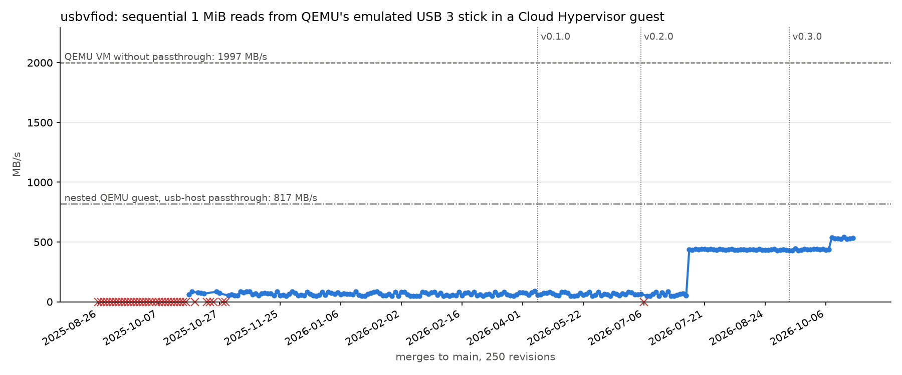

# usbvfiod performance across its history

Measures how fast a Cloud Hypervisor guest reads from a USB 3 stick passed
through with [usbvfiod](https://github.com/cyberus-technology/usbvfiod), for
every merge to `main` since USB storage works (PR #63, 2025-08-26).



A run from 2026-10-18 on a Framework Laptop 13 with an AMD Ryzen 5 7640U
([machine](sample-measurement/2026-10-18_fw13/sysinfo.txt),
[results](sample-measurement/2026-10-18_fw13/results.csv)). Red crosses
mark revisions without a result.

The stick is QEMU's emulated USB 3 `usb-storage` device, as in usbvfiod's own
integration tests, backed by a 1 GiB file of random data:

```
host
└── QEMU VM (qemu-xhci + emulated USB stick)
    ├── baseline: fio directly on the stick
    ├── qemu-usb-host: nested QEMU (usb-host) ── guest: fio on the passed-through stick
    └── usbvfiod ── Cloud Hypervisor ── guest: fio on the passed-through stick
```

Both passthrough setups boot the same nested guest image. `usbbench` first
runs the two baselines once each:

- `baseline`: fio directly in the QEMU VM. This is the upper bound without
  any passthrough.
- `qemu-usb-host`: the stick passed through with QEMU's own `usb-host` device
  to a nested QEMU guest. This is what an established VMM achieves at the same
  nesting depth, and so the fair comparison for usbvfiod.

Then for each merge it

1. builds usbvfiod with that revision's own `flake.lock` (tests skipped),
2. boots a fresh QEMU VM, which starts that usbvfiod with the stick and a
   fixed Cloud Hypervisor with a fixed NixOS guest,
3. lets the guest read `/dev/sda` sequentially in 1 MiB blocks for 15 s, three
   times (fio, read-only, `O_DIRECT`, queue depth 1). 1 MiB is the largest
   command the guest's usb-storage driver sends to a USB 3 device,
4. appends the results to `usbbench-work/results.csv`.

At the end it draws `usbbench-work/plot.png`: the median of the three
repetitions per merge, with failed revisions and releases marked and the
two baselines as reference lines.

Everything except usbvfiod is pinned by this flake, so only usbvfiod changes
between measurements. The nested guest runs inside the QEMU VM, which makes
every VM exit expensive. The numbers are meant for comparing
usbvfiod revisions with each other, not as real-world throughput.

## Running

Requirements: x86_64 Linux, Nix with flakes, `/dev/kvm` access, and nested
virtualization (`cat /sys/module/kvm_intel/parameters/nested` or
`/sys/module/kvm_amd/parameters/nested` shows `Y` or `1`).

```console
$ nix run .
```

The whole run takes a night. It can be interrupted at any time; a rerun skips
everything that already has results. To retry a revision, delete its lines
from `results.csv`.

The console of each QEMU VM, including the logs of usbvfiod, Cloud Hypervisor
and the guest, is in `usbbench-work/runs/<rev>/vm.log`, next to the build log.
